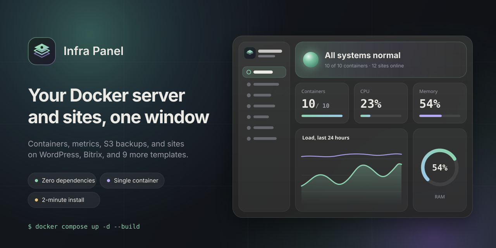

<p align="center">
  
</p>

<h3 align="center">A calm, fast control panel for a single Docker server</h3>

<p align="center">
  Containers, live metrics, S3 backups, and one-click sites on WordPress, Bitrix, and 9 more templates.<br>
  Plain Node.js, zero dependencies, one container. Up and running in two minutes.
</p>

<p align="center">
  
  
  
  
</p>

<p align="center">
  <a href="#why-infra-panel">Why</a> ·
  <a href="#features">Features</a> ·
  <a href="#install">Install</a> ·
  <a href="#https">HTTPS</a> ·
  <a href="#updating">Updating</a> ·
  <a href="#security">Security</a> ·
  <a href="README.ru.md">Русский</a>
</p>

---

## Why Infra Panel

**Nothing to maintain.** No npm packages, no build step, no database. Two JavaScript files and the Docker socket. Fewer moving parts means fewer updates, fewer CVEs, and nothing to break on upgrade.

**Built for one server, not a cluster.** Portainer and Rancher are made for fleets. Infra Panel is made for the VPS that runs your company site, your CRM, and a few client projects, and shows exactly that, without layers of abstraction.

**Sites, not just containers.** Pick a template, type a domain, press one button. You get the container, its own MariaDB database and user, a reverse-proxy block, and an HTTPS certificate. Credentials are shown once, right after creation.

**Backups that leave the server.** Every volume and config in one archive, on a schedule, uploaded to any S3-compatible storage. Old copies are pruned automatically.

**Pleasant to look at all day.** A soft glass interface with a muted palette, animated metrics, and plain-language status: "All systems normal", not `SYS·NOMINAL`. Works on a phone too.

**Secure by default.** Listens on localhost only, signed sessions, CSRF and brute-force protection, strict content security policy. See [Security](#security).

## Features

| Area | What you can do |
|---|---|
| **Overview** | Server health at a glance: containers, CPU, memory, disk, 24-hour load chart, live Docker events, and alerts |
| **Containers** | Start, stop, pause, restart, or kill; stream logs; run commands inside; download logs and config. Every action lives in a ≡ menu on each row |
| **Sites** | HTTP status, response time, and uptime for every domain in your Caddyfile |
| **New site** | 11 templates: static site, WordPress, Joomla, Drupal, 1C-Bitrix, OpenCart, PrestaShop, Nextcloud, n8n, Jenkins, and an Ubuntu server with SSH. Live validation and a preview of everything that will be created |
| **Images, volumes, networks** | Search, filter, check for image updates, remove unused images in one click |
| **Backups** | Back up all volumes and configs on demand or on a schedule. Upload to Yandex Object Storage, Selectel, Cloudflare R2, Backblaze B2, or any S3 endpoint |
| **Files** | Browse and edit deployment files in the browser, with an automatic copy before every save |

## Install

### Quick install

One command checks Docker, clones this repository to `~/infra-panel`, writes `.env` (asks for a login and password), creates `/opt/fleet/deploy` and `/opt/fleet/backups`, and starts the container:

```bash
curl -fsSL https://raw.githubusercontent.com/spinn26/infra-panel/main/install.sh | bash
```

Prefer to do it by hand? Follow the steps below.


**You need** a Linux server with Docker 24+ and the Compose plugin. A VPS with 1 GB of RAM is enough.

### 1. Get the code

```bash
git clone https://github.com/spinn26/infra-panel.git
```

```bash
cd infra-panel
```

### 2. Configure

```bash
cp .env.example .env
```

Generate a strong password:

```bash
openssl rand -base64 24
```

Find the ID of the `docker` group:

```bash
getent group docker | cut -d: -f3
```

Put both values into `.env`:

```ini
ADMIN_PASSWORD=your-generated-password
DOCKER_GID=docker-group-id
```

### 3. Prepare directories

```bash
sudo mkdir -p /opt/fleet/deploy /opt/fleet/backups
```

```bash
sudo touch /opt/fleet/deploy/Caddyfile
```

### 4. Start

```bash
docker compose up -d --build
```

Open **http://127.0.0.1:18080** and sign in as `admin`. On a remote server, forward the port over SSH:

```bash
ssh -L 18080:127.0.0.1:18080 user@your-server
```

To confirm it started, follow the logs and look for `Infra Panel :8080 (user: admin)`:

```bash
docker compose logs -f panel
```

## HTTPS

The panel only listens on `127.0.0.1`. To reach it from a domain, put a reverse proxy with TLS in front of it. With Caddy:

```caddy
panel.example.com {
	reverse_proxy 127.0.0.1:18080
}
```

Caddy obtains the certificate automatically, and the panel marks its session cookie `Secure` when served over HTTPS.

## Configuration

Everything is set in `.env`.

| Variable | Purpose | Default |
|---|---|---|
| `ADMIN_USER` | Login name | `admin` |
| `ADMIN_PASSWORD` | Password. **Required**: without it nobody can sign in | — |
| `PANEL_SECRET` | Key for signing sessions. If unset, a new one is generated on every start and everyone has to sign in again | random |
| `HOST_DEPLOY_HOST` | Deployment directory on the host: site files and the Caddyfile live here | `/opt/fleet/deploy` |
| `HOST_BACKUPS_DIR` | Backup directory on the host | `/opt/fleet/backups` |
| `HOST_PUBLIC_IP` | Public IP of the server, shown in the SSH hint for the Ubuntu template | — |
| `DOCKER_GID` | ID of the `docker` group on the host | `985` |
| `ROOT_404_OK` | Comma-separated domains where a 404 on the root page is expected, such as an API without a home page. They count as online and raise no alert | — |

## Updating

```bash
git pull
```

```bash
docker compose up -d --build
```

Settings, load history, and backups live in volumes and survive updates.

## How it works

- `server.js` is the HTTP server, API, built-in pages, backups, and S3 client. It talks to Docker directly through `/var/run/docker.sock`.
- `client.js` is the interface, written in plain JavaScript with no build step.
- Sites run as `aksite-<name>` containers on a shared network, with data in `aksite-<name>-data` volumes. Each site gets a block appended to the host's Caddyfile. That block uses an `import secure` snippet; if your Caddyfile doesn't define it, adjust `createSite` in `server.js`.

## Security

> [!WARNING]
> The panel controls `docker.sock`, which is equivalent to root access on the server. Only expose it over HTTPS and with a strong password.

Built in:

- **Sign-in limits:** 5 failed attempts per IP and 50 in total per 10 minutes. Spoofing `X-Forwarded-For` doesn't bypass them.
- **Sessions:** signed cookies with `HttpOnly`, `SameSite=Strict`, and `Secure` over HTTPS. Passwords and signatures are compared in constant time.
- **CSRF protection:** state-changing requests from other sites are rejected.
- **Headers:** `Content-Security-Policy`, `X-Frame-Options: DENY`, `nosniff`.
- **Input checks:** file paths and container IDs are validated, and request bodies are capped at 2 MB.
- **Secrets:** the S3 secret key is never sent to the browser.

## License

MIT, see [LICENSE](LICENSE). Made by [AK Systems](https://aksystems.pro).
