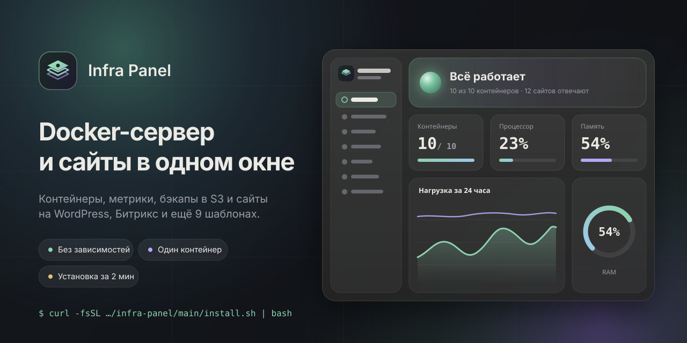

<p align="center">
  
</p>

<p align="center">
  <b>Панель управления Docker-сервером и сайтами.</b><br>
  Чистый Node.js без зависимостей и сборки. Один контейнер, установка за пару минут.
</p>

<p align="center">
  <a href="#установка">Установка</a> ·
  <a href="#возможности">Возможности</a> ·
  <a href="#https-и-доступ-снаружи">HTTPS</a> ·
  <a href="#обновление">Обновление</a> ·
  <a href="#безопасность">Безопасность</a> ·
  <a href="README.md">English</a>
</p>

---

## Возможности

| | |
|---|---|
| **Обзор** | Состояние сервера одним взглядом: контейнеры, CPU, память, диск, график нагрузки за 24 часа, события Docker и предупреждения |
| **Контейнеры** | Запуск, остановка, пауза, перезапуск, логи в реальном времени, команды внутри контейнера, выгрузка логов и конфигурации. Всё в меню ≡ у каждой строки |
| **Сайты** | Код ответа, время отклика и аптайм каждого домена из Caddyfile |
| **Новый сайт** | 11 шаблонов: статический сайт, WordPress, Joomla, Drupal, 1С-Битрикс, OpenCart, PrestaShop, Nextcloud, n8n, Jenkins, сервер Ubuntu с SSH. База MariaDB и HTTPS-сертификат создаются сами |
| **Образы, тома, сети** | Поиск, фильтры, проверка обновлений, очистка неиспользуемых образов в один клик |
| **Бэкапы** | Архив всех томов и конфигов по кнопке или по расписанию, выгрузка в S3: Яндекс Object Storage, Selectel, Cloudflare R2, Backblaze B2 |
| **Файлы** | Просмотр и правка файлов деплоя в браузере. Перед сохранением делается копия |

## Установка

### Быстрая установка

Одна команда проверит Docker, склонирует репозиторий в `~/infra-panel`, создаст `.env` (спросит логин и пароль), каталоги `/opt/fleet/deploy` и `/opt/fleet/backups` и запустит контейнер:

```bash
curl -fsSL https://raw.githubusercontent.com/spinn26/infra-panel/main/install.sh | bash
```

Вручную — по шагам ниже.


**Что нужно:** Linux-сервер с Docker 24+ и плагином Compose. Подойдёт VPS от 1 ГБ RAM.

### 1. Скачайте панель

```bash
git clone https://github.com/spinn26/infra-panel.git
cd infra-panel
```

### 2. Настройте

```bash
cp .env.example .env
```

Сгенерируйте пароль и узнайте номер группы `docker`:

```bash
openssl rand -base64 24
```

```bash
getent group docker | cut -d: -f3
```

Откройте `.env` и впишите оба значения:

```ini
ADMIN_PASSWORD=сгенерированный_пароль
DOCKER_GID=номер_группы_docker
```

### 3. Подготовьте каталоги

```bash
sudo mkdir -p /opt/fleet/deploy /opt/fleet/backups
```

```bash
sudo touch /opt/fleet/deploy/Caddyfile
```

### 4. Запустите

```bash
docker compose up -d --build
```

Панель откроется по адресу **http://127.0.0.1:18080**. Если сервер удалённый, пробросьте порт через SSH:

```bash
ssh -L 18080:127.0.0.1:18080 user@ваш-сервер
```

Проверить, что всё поднялось:

```bash
docker compose logs -f panel
```

В логе должна появиться строка `Infra Panel :8080 (user: admin)`.

## HTTPS и доступ снаружи

Панель слушает только `127.0.0.1`. Чтобы открыть её по домену, поставьте перед ней reverse proxy с TLS. Пример для Caddy:

```caddy
panel.example.ru {
	reverse_proxy 127.0.0.1:18080
}
```

Caddy сам выпустит сертификат. Панель распознает HTTPS и пометит cookie флагом `Secure`.

## Настройки

Все параметры задаются в `.env`.

| Переменная | Назначение | По умолчанию |
|---|---|---|
| `ADMIN_USER` | Логин | `admin` |
| `ADMIN_PASSWORD` | Пароль. **Обязателен**, без него вход невозможен | — |
| `PANEL_SECRET` | Ключ подписи сессий. Если не задан, генерируется при каждом старте, и после перезапуска нужно войти заново | случайный |
| `HOST_DEPLOY_HOST` | Каталог деплоя на хосте: сюда пишутся файлы сайтов и Caddyfile | `/opt/fleet/deploy` |
| `HOST_BACKUPS_DIR` | Каталог бэкапов на хосте | `/opt/fleet/backups` |
| `HOST_PUBLIC_IP` | Публичный IP сервера, подставляется в подсказку SSH для шаблона Ubuntu | — |
| `DOCKER_GID` | Номер группы `docker` на хосте | `985` |
| `ROOT_404_OK` | Домены через запятую, для которых ответ 404 на главной — норма (например, API без главной страницы). Считаются доступными и не дают предупреждений | — |

## Обновление

```bash
git pull
```

```bash
docker compose up -d --build
```

Настройки, история нагрузки и бэкапы хранятся в томах и при обновлении сохраняются.

## Как устроено

- `server.js` — HTTP-сервер, API, встроенные страницы, бэкапы и S3. Общается с Docker напрямую через `/var/run/docker.sock`.
- `client.js` — интерфейс на чистом JavaScript, без сборки.
- Сайты создаются как контейнеры `aksite-<имя>` в общей сети, данные лежат в томах `aksite-<имя>-data`. Блок для сайта дописывается в Caddyfile хоста. Шаблон блока использует сниппет `import secure`: если его нет в вашем Caddyfile, поправьте функцию `createSite`.

## Безопасность

> [!WARNING]
> Панель управляет `docker.sock`, а это равносильно root-доступу к серверу. Открывайте её снаружи только через HTTPS и с сильным паролем.

Что уже встроено:

- вход: не больше 5 неудачных попыток за 10 минут с одного IP и 50 попыток суммарно; подмена `X-Forwarded-For` лимит не обходит;
- сессии: подписанные cookie `HttpOnly`, `SameSite=Strict`, `Secure` при HTTPS, сравнение подписи и пароля за постоянное время;
- защита от CSRF: изменяющие запросы с чужих сайтов отклоняются;
- заголовки `Content-Security-Policy`, `X-Frame-Options: DENY`, `nosniff`;
- проверка путей в файловом менеджере и ID контейнеров, лимит размера запроса 2 МБ;
- секретный ключ S3 не передаётся в браузер.

## Лицензия

MIT — см. [LICENSE](LICENSE). Разработано в [AK Systems](https://aksystems.pro).
